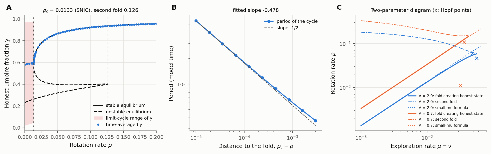

<!-- Generated from docs_src/README.md.in by experiments/render_docs.py; edit the template, not this file. -->
# Who guards the guardians when the guardians rotate?

Umpire rotation and inherited integrity in an evolutionary model of institutional corruption.

Institutions that punish free riders can keep cooperation going, but the officials who run them
can become corrupt. Lee, Iwasa, Dieckmann and Sigmund (2019) showed in an evolutionary game model
that social learning then produces recurring cycles of corruption. This repository reproduces
their model, checked against the paper and its SI Appendix, and asks what happens when the
officials ("umpires") serve limited terms and are replaced by newcomers. There are three main
findings. First, in the deterministic large-population model, rotation with honest newcomers
removes the corruption cycles once the rotation rate passes a critical value
(rho_c = 0.0133); in stochastic simulations of small populations it raises the share of honest
umpires from 0.669 to 0.978 (rotation rate 0 to 0.3 per
generation). Second, rotation makes players less vigilant, as
expected, but the corruption episodes that remain become shallower and shorter, not deeper.
Third, when newcomers inherit the integrity of the body they join, much of the benefit of
rotation is lost; with linear inheritance, rotation acts exactly like slower rotation with fresh
newcomers (mean field).



*Mean-field bifurcation in the rotation rate rho (mu = nu = 0.01, other parameters as in Lee
et al. 2019). (A) Honest umpire fraction: below rho_c the system cycles (shaded band: range of
the cycle); above it a stable honest equilibrium exists. (B) Near rho_c the cycle period grows
like (rho_c - rho)^(-1/2), the signature of a saddle-node bifurcation on the cycle. (C) rho_c grows
in proportion to the exploration rate until close to the Hopf points (crosses).*

**Original work.** This project reproduces and extends:

> Lee J-H, Iwasa Y, Dieckmann U, Sigmund K (2019). Social evolution leads to persistent
> corruption. *Proceedings of the National Academy of Sciences* 116(27):13276-13281.
> doi:[10.1073/pnas.1900078116](https://doi.org/10.1073/pnas.1900078116)

The base model, its parameters and its benchmarks are theirs. The rotation extension, its
analysis and the results on hypotheses H1 to H6 are new.

**Read more:** [paper (PDF)](paper/main.pdf) (single-column preprint draft; an IEEE two-column
version is in [paper/ieee/main_ieee.pdf](paper/ieee/main_ieee.pdf)),
[FINAL_REPORT.md](FINAL_REPORT.md) (what was reproduced and how closely, hypothesis outcomes,
limitations) and [CHANGES_SI.md](CHANGES_SI.md) (verification against the SI Appendix).

> **SI verification.** The SI Appendix of Lee et al. (2019) was checked line by line
> ([SI_EXTRACT.md](SI_EXTRACT.md), [CHANGES_SI.md](CHANGES_SI.md)). Every rule it states holds in
> our model, and its Fig. 8 supports our time unit. It does not describe the order of individual
> updates or how role models are sampled; these remain documented assumptions
> ([SPEC.md](SPEC.md) Section 8). The rerun after the verification changed no simulation result
> and no hypothesis outcome.

## Question

In the model of Lee et al., players play a donation game supervised by umpires who are either
honest (they fine defectors) or corrupt (they take bribes). Players can pay a cost h to check
their umpire. Social learning produces cycles: honest periods let checking lapse, corruption
spreads, cooperation collapses, prudent checking returns, and honesty recovers.
We ask: what happens when umpires serve limited terms and are replaced by newcomers? Does rotation
keep institutions honest, does it remove the cycles, and what if newcomers inherit the integrity
of the body they join (linearly, by conformity, or with a delay)?

## Main results

All numbers below are generated from `results/full/` (see `results/full/numbers.md`). "Mean field"
means the deterministic large-population equations; "IBM" means the stochastic individual-based
model. The two are reported separately.

**Reproduction (Lee et al. 2019)**

| Benchmark | Paper | This repository | Status |
|---|---|---|---|
| B1: all umpires corrupt, OD -> h/(f+B) | 0.25, PC 0.75 | 0.25, 0.75 (max deviation 4.8e-12 over 20 starts) | reproduced |
| B2: all umpires honest, OC -> 1 | 1 | 1 (max deviation 2.4e-11) | reproduced |
| B3: rare-exploration H:C ratio, N = 10 | (19N+87):109 = 2.54 | 2.541, derived independently and symbolically | reproduced |
| B3: simulated H:C ratio | about 2.15 | ratio of mean shares 2.030 [2.003, 2.057]; time all honest / all corrupt 2.134 [2.102, 2.165] (30 runs of 200000 generations) | matched under the Markov-type definition; not under the ratio of mean shares |
| B4: sustained cycles (M = 50, N = 10) | about 7 episodes per 10^5 steps (read from Fig. 1) | 6.0 [6.0, 6.1] | reproduced |
| B4: damped oscillations (M = 5000, N = 1000) | corrupt fraction about 0.5-0.55 (Fig. 1D) | 0.541 [0.535, 0.545]; mean-field focus, eigenvalues -0.0081 +- 0.0089i | reproduced |
| B4: orbit shrinkage with exploration | qualitative (Fig. 3) | Hopf point at mu = nu = 0.0616 (A = 2), 0.0314 (A = 0.7) | reproduced |

The simulated ratio moves toward the Markov value as exploration becomes rarer:
2.318 at mu = 3e-4 and 2.459 at mu = 1e-4. At mu = 1e-3 the result depends
on how the time average is defined, and neither the paper nor its SI states which definition was
used. The time with all umpires honest over the time with all umpires corrupt is the quantity
that the rare-exploration Markov chain predicts; under it our simulation agrees with the
published 2.15. The ratio of mean shares does not (2.037 even in runs of
2.2e8 steps). Other candidate causes (burn-in, imitation strength, exploration and payoff
conventions) were checked and do not explain the difference ([CHANGES_SI.md](CHANGES_SI.md)).

**Extension (new; author's design)**

1. *Rotation removes corruption cycles through a saddle-node on invariant circle (mean field).*
   At the default exploration rate (mu = nu = 0.01) there is no Hopf bifurcation in the
   rotation rate rho. A stable honest equilibrium appears in a fold at rho_c = 0.0133 that lies
   on the limit cycle; the period diverges with exponent -0.478 (theory: -1/2). A
   small-exploration formula gives rho_c = 0.0137 (2.5% error) and shows that
   rho_c is proportional to the exploration rate (rho_c / mu = 1.36 for A = 2).
2. *H1 supported.* Rotation raises time-averaged honesty and damps cycles: IBM small population
   0.669 -> 0.978 (rho = 0 -> 0.3 per generation), corruption
   episodes 3.63 -> 0.29 per 1000 generations.
3. *H2 (vigilance paradox) not supported.* Rotation does lower vigilance (prudent cooperators
   0.210 -> 0.006), but the remaining corruption episodes are shallower and
   shorter, not deeper (lowest cooperation in an episode 0.262 -> 0.643;
   duration 88.1 -> 23.3 generations).
4. *H3 supported.* Inheritance weakens rotation in all three variants. Linear inheritance is
   exactly fresh rotation at rho (1 - kappa) in the mean field. In the IBM the equivalence fails
   the strict pre-registered test at 2 of 15 points (largest
   difference 0.0073) and holds after Bonferroni adjustment.
5. *H4: substitutes.* Rotation helps honesty more when transparency is costly (gain at
   rho = 0.05: 0.134 at h = 0.02 vs 0.478 at h = 0.28). For cooperation the
   pattern is mixed.
6. *H5 mixed.* Conformist inheritance produces bistability only when newcomers almost purely
   copy the majority (kappa >= 0.95 at default parameters) and rotation is fast.
   The pre-registered hysteresis sweep shows no loop; a post-hoc sweep from the corrupt state does.
   The IBM shows no dependence on the starting state.
7. *H6 not supported.* Delayed inheritance never destabilized the honest equilibrium
   (1375 parameter points; rightmost root real part at most -3.2e-4).
8. *Robustness.* Replacing a whole cohort at once (pulses) gives more honesty than continuous
   rotation at the same average rate (IBM: 0.802 -> 0.899). Newcomers who are
   not reliably honest (p0 = 0.6) can make moderate rotation lower honesty (minimum 0.484).

Note on novelty: in the mean field, fresh-cohort rotation is algebraically the same as umpire
exploration biased toward honesty (DECISIONS.md D-015). Related ideas (enforcer "education",
higher enforcer exploration) appear in Lee et al. (2015) and Zhou et al. (2023). To our knowledge
the bifurcation structure and the inheritance variants have not been studied in this model.

## Repository layout

```
src/            model code (payoffs, ODE, DDE, IBM, Markov chain, rotation, analysis, metrics)
experiments/    digitize_si.py, run_reproduction.py, run_extension.py, run_sensitivity.py,
                evaluate_hypotheses.py, make_figures.py, make_numbers.py,
                make_changes_si.py, render_docs.py
tests/          pytest suite (payoffs, fixed points, IBM vs ODE, Markov chain, rotation limits,
                rho_eff equivalence, rules stated in the SI)
configs/        base.yaml, quick.yaml, full.yaml
results/        JSON outputs with config hash and git commit (full/ is the reported run;
                quick/ is generated locally); pre_si/ holds the numbers before the SI check
figures/        PNG and vector PDF (figures/quick/ is generated locally)
paper/          main.tex, references.bib, autogen_numbers.tex, main.pdf
  ieee/         main_ieee.tex (IEEEtran journal), refs_ieee.bib (generated), main_ieee.pdf
docs_src/       templates for the Markdown documents (numbers are filled in automatically)
```

Key documents: [SPEC.md](SPEC.md) (model with source locations), [DECISIONS.md](DECISIONS.md),
[METRICS.md](METRICS.md) (pre-registered metrics and decision rules), [PROGRESS.md](PROGRESS.md),
[REVIEW.md](REVIEW.md),
[FINAL_REPORT.md](FINAL_REPORT.md), [CITATIONS_TODO.md](CITATIONS_TODO.md),
[SI_EXTRACT.md](SI_EXTRACT.md) (what the SI specifies), [CHANGES_SI.md](CHANGES_SI.md) (effect of
the SI verification), [WORDING_AUDIT.md](WORDING_AUDIT.md) (how the notation inconsistencies are
described).

## How to run

Requirements: Python 3.11 or 3.12, the packages in `requirements.txt` (or `environment.yml`), and
a TeX distribution (TeX Live or MiKTeX) to build the paper. On Windows, use `mingw32-make` in
place of `make`, or `python run_all.py`. The reference PDFs (the paper and its SI) are
copyrighted and not distributed; the pipeline runs without them and then uses the committed SI
read-offs in `results/full/si_digitized.json`.

```bash
pip install -r requirements.txt   # install
python -m pytest                  # 100 tests, under a minute
make quick                        # quick pipeline: small grids, few replicates
make all                          # full pipeline: tests, all experiments, figures, numbers, docs, paper
python run_all.py full            # the full pipeline without make
```

Expected runtimes on a 16-thread laptop (14 worker processes): about 3 minutes
for the quick pipeline and about 17 minutes of recorded compute for the full
pipeline, plus about a minute to build the two papers. `make numbers docs paper` regenerates the
number macros, the Markdown documents and the PDFs from the committed results without rerunning
the experiments.

Individual steps: `python experiments/digitize_si.py full` (reads the SI PDF from refs/ if it is
present), `python experiments/run_reproduction.py full`,
`python experiments/run_extension.py full [bif e1 e2 e3 e4 e5 e5b e6]`,
`python experiments/run_sensitivity.py full`, `python experiments/evaluate_hypotheses.py full`,
`python experiments/make_figures.py full`, `python experiments/make_numbers.py full`,
`python experiments/make_changes_si.py`, `python experiments/render_docs.py`,
`python experiments/build_paper.py`.

## Tools and assistance

The implementation and analysis were carried out with the help of AI coding tools (Claude Code)
under the author's direction. The research question, the extension and the hypotheses were set
by the author in a project brief. Every number in the documents and the paper is generated
from the result files by scripts, and the test suite checks the code against the published
equations and benchmarks.

## Reproduction notes: notation inconsistencies and how we resolved them

The reproduction relies on the clear and detailed description of the model by Lee et al. (2019)
and its SI. In a few places the printed text or figures can be read in more than one way. None of
these affects the conclusions of the original paper.

| ID | Where | Observation | How we resolved it |
|---|---|---|---|
| D1 | Methods p.13281 | Q(y) is printed as y1 Q_C + (1 - y1) Q_H, while y1 denotes the honest fraction (in the PDF as well as on PMC) | We read it as Q(y) = y1 Q_H + (1 - y1) Q_C, which gives the stated results B1 and B2 (a test shows that the literal reading does not give B1) |
| D2 | Methods p.13281 | The honest mixed state is labelled "OD+PD (a mixture of OD and PC)" | We read it as a mixture of OD and PD (Fig. 2 caption, Q_H) |
| D3 | Fig. 3 caption | "8 or 9, respectively" lists the states in the opposite order to the panels (the SI, p.1, follows the panels) | With A = 2 the orbit passes state 9 (distance 0.142), with A = 0.7 state 8 (distance 0.022); explained by the invasion thresholds y_PD = 0.333, y_OD = 0.167 (A = 2) or 0.600 (A = 0.7) |
| D4 | Transition matrix T | Row 3 has no entry for allOD (H) -> allOD (C), while the SI text (p.2) describes corrupt umpires invading this state | State 3 is transient, so the stationary distribution is the same with or without the entry (symbolic check) |
| D6 | Fig. 3C, D | The caption refers to the orange orbit (mu = nu = 1e-4, period 9437 time units) | The values in the panels match the mu = nu = 0.02 orbit, which we use for comparison (period 136.5; peaks OC 0.923, PC 0.697, PD 0.438, OD 0.268) |
| D7 | SI Fig. 9 | The axis labels of the panels are exchanged relative to the caption | We follow the caption; the ranges, the Hopf boundary and the periods then agree with our model |
| U1-U4 | SI Appendix | Read in full ([SI_EXTRACT.md](SI_EXTRACT.md)) | Exploration rules verified; time unit supported by SI Fig. 8; update order and role-model sampling not stated (assumptions kept); T derivation verified; averaging behind 2.15 not stated |
| PMC | Web version | The PMC web version does not display the minus signs of the payoff matrices | All signs read from the PDF at 300 dpi and checked symbolically |

## Citation

Citation metadata is in [CITATION.cff](CITATION.cff). If you use this code, cite the original
model:

Lee J-H, Iwasa Y, Dieckmann U, Sigmund K (2019). Social evolution leads to persistent corruption.
*Proceedings of the National Academy of Sciences* 116(27):13276-13281. doi:10.1073/pnas.1900078116

and this repository: Aziz, M. A. A. (2026). Umpire rotation and inherited integrity in an
evolutionary model of institutional corruption (code and preprint draft). [repository URL]

## License

MIT (see [LICENSE](LICENSE)). The reference PDFs in `refs/` are not part of the repository.
